# Wave-farm power prediction: classical ML vs deep learning

[](https://github.com/santoshmyakala/wave-energy-farm-ml/actions/workflows/ci.yml)


A wave farm's output depends on **where its buoys sit relative to each other**: each converter changes the waves its neighbours receive. This project predicts the total power of a 16-buoy farm from the buoy coordinates alone. It uses ~260,000 simulated layouts at four Australian sites (Adelaide, Perth, Sydney, Tasmania) and compares:

| Family | Model | Representation |
|---|---|---|
| Baselines | Mean predictor, Ridge regression | Coordinates sorted into a canonical buoy order |
| Gradient boosting | `HistGradientBoostingRegressor` | (a) canonical coordinates · (b) hand-built interaction features (sorted pairwise distances, \|dx\|, \|dy\|, nearest-neighbour spacing) |
| Deep learning | MLP (4 × 512, GELU) | Canonical coordinates |
| Deep learning | **Set transformer**: self-attention over buoys with a learned **relative-position attention bias** | Raw coordinates; permutation-equivariant; predicts each buoy's power and sums them |

> Started as a machine-learning exercise during my PG Diploma in Machine Learning (Imarticus Learning). The original code wasn't kept, so this is a fresh implementation.

## Key findings

1. **Clean the data before splitting.** **27,174 of Sydney's 72,000 rows are exact duplicates.** A naive random split would put more than a third of them in both the training and test sets. 26 rows across the sites also have a total that disagrees with the sum of buoy powers. Both are removed and reported ([data/README.md](data/README.md)).
2. **Random splits overstate accuracy on this dataset.** Rows close together in each file are similar layouts, so a random split leaks near-duplicates into the test set. Holding out the **last 15% of each file** (the "blocked" split) drops gradient boosting from R² ≈ 0.91–0.95 to ≈ 0.77–0.80. The blocked numbers are the honest estimate for genuinely new layouts.
3. **The set transformer is the strongest model when it trains fully.** On Perth and Sydney it ran all 40 epochs and cut RMSE about 3× compared with gradient boosting (R² 0.992 and 0.984). On Adelaide and Tasmania, early stopping (patience 10) ended training during the high-learning-rate phase of the one-cycle schedule, at epochs 19 and 18, and it under-performed. Next step: re-run with `--patience 40` and evaluate it on the blocked split.
4. **Hand-built "physics" features aren't a free win.** Order-invariant distance features beat raw coordinates only at Sydney. Elsewhere they lose the absolute position information that evidently matters, plausibly through orientation to the prevailing waves.

## Results

Test set = 15% of cleaned rows, seed 42, R² on total farm power. Full tables with RMSE, MAPE and fit time: [`reports/random/results.md`](reports/random/results.md) · [`reports/blocked/results.md`](reports/blocked/results.md).

**Random split**

| Model | Adelaide | Perth | Sydney | Tasmania |
|---|---:|---:|---:|---:|
| Mean baseline | 0.000 | 0.000 | 0.000 | 0.000 |
| Ridge (coords) | 0.811 | 0.794 | 0.614 | 0.719 |
| Gradient boosting (coords) | **0.947** | 0.935 | 0.907 | **0.913** |
| Gradient boosting (interactions) | 0.825 | 0.797 | 0.972 | 0.782 |
| MLP | 0.927 | 0.913 | 0.864 | 0.891 |
| Set transformer | 0.883 † | **0.992** | **0.984** | 0.842 † |

† Stopped early at epoch 19 (Adelaide) and 18 (Tasmania) of 40; see finding 3.

Set-transformer RMSE: Perth **4.8 kW** vs 13.3 kW for gradient boosting; Sydney **3.1 kW** vs 7.4 kW, on farms producing about 1.4–1.5 MW.

**Blocked split** (last 15% of each file held out; set transformer not run on this split)

| Model | Adelaide | Perth | Sydney | Tasmania |
|---|---:|---:|---:|---:|
| Mean baseline | −0.127 | −1.414 | −0.907 | −0.969 |
| Ridge (coords) | **0.779** | 0.450 | 0.209 | 0.468 |
| Gradient boosting (coords) | 0.774 | **0.789** | 0.777 | **0.802** |
| Gradient boosting (interactions) | 0.503 | 0.256 | **0.951** | 0.413 |
| MLP | 0.737 | 0.740 | 0.511 | 0.772 |

The strongly negative mean-baseline R² confirms the held-out tail of each file differs systematically from the rest: real distribution shift, not noise.

## Method

<picture>
  <source media="(prefers-color-scheme: dark)" srcset="docs/diagrams/pipeline-dark.svg">
  
</picture>

<sub>Animated diagram generated from <a href="docs/diagrams">docs/diagrams/*.yaml</a> with <a href="https://github.com/santoshmyakala/santoshmyakala/tree/main/tools/archdiagram">archdiagram</a>.</sub>

### The set transformer

<picture>
  <source media="(prefers-color-scheme: dark)" srcset="docs/diagrams/set-transformer-dark.svg">
  
</picture>

- **Permutation-equivariant by construction.** Renumbering the buoys permutes the per-buoy outputs and leaves the total unchanged. This is asserted in `tests/test_features_models.py`.
- **Relative-position bias.** Interaction between two buoys depends on their offset, so attention logits get a learned function of (dx, dy, distance).
- **Auxiliary supervision.** The dataset includes each buoy's power, so the model is trained on all 16 per-buoy targets as well as the total.

## Quick start

```bash
git clone https://github.com/santoshmyakala/wave-energy-farm-ml.git
cd wave-energy-farm-ml
python -m venv .venv && source .venv/bin/activate
pip install torch --index-url https://download.pytorch.org/whl/cpu
pip install -e ".[dev,track]"
```

Smoke run on the committed 1,500-row samples (a minute or so):

```bash
python -m wec.benchmark --data-dir data/sample --epochs 3 --no-mlflow --out smoke
```

Full benchmark: download the four CSVs from the UCI repository into `data/raw/` (see [data/README.md](data/README.md)).

```bash
python -m wec.benchmark --data-dir data/raw --splits random --epochs 40 --out reports/random
```

```bash
python -m wec.benchmark --data-dir data/raw --splits blocked --models mean_baseline ridge_coords hgb_coords hgb_interactions mlp --out reports/blocked
```

Options: `--sites`, `--models`, `--splits random blocked`, `--epochs`, `--patience`, `--max-rows`, `--seed`. Every run is logged to MLflow (`mlflow ui --backend-store-uri sqlite:///mlflow.db`) unless you pass `--no-mlflow`.

Compute note: the reported run was on a 4-core CPU shared with other jobs, so fit times are indicative only. The set transformer took 6–15 minutes per site.

## Testing

```bash
pytest -q
```

The 10 tests cover:
- the schema of all four sample files;
- that the cleaning logic removes duplicates and inconsistent totals;
- that the splits are disjoint and complete (and that the blocked split really holds out the tail);
- that both representations are invariant to buoy order;
- that the set transformer is permutation-invariant for the total and equivariant per buoy;
- an end-to-end benchmark smoke run.

CI runs lint, the tests and a benchmark smoke run on every push.

## Roadmap

- [ ] Re-run the set transformer with `--patience 40`, and on the blocked split.
- [ ] Grouped cross-validation by contiguous file blocks instead of a single held-out tail.
- [ ] Train one model across all sites with a site embedding (transfer between wave climates).
- [ ] Use the set transformer as a fast surrogate inside a layout optimiser.

## Licence and attribution

Code: MIT. Data: *Wave Energy Converters* dataset, UCI Machine Learning Repository (Neshat et al.), CC BY 4.0. The 1,500-row samples in `data/sample/` are redistributed under the same licence.
